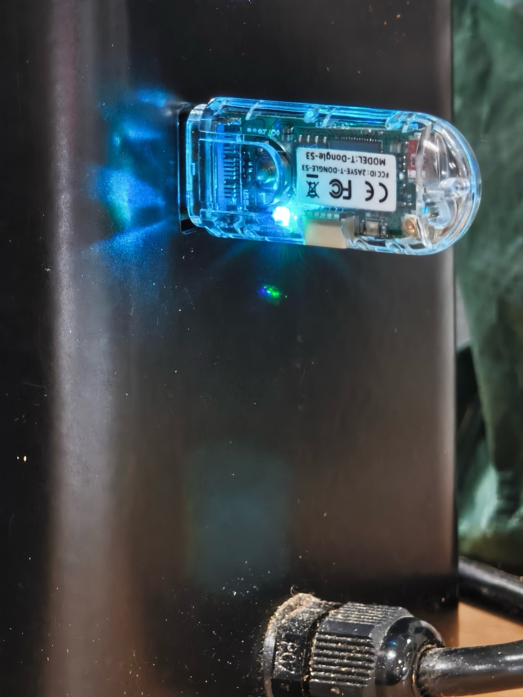
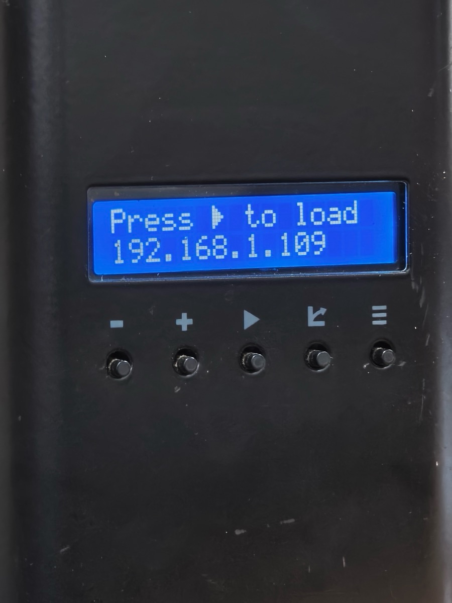
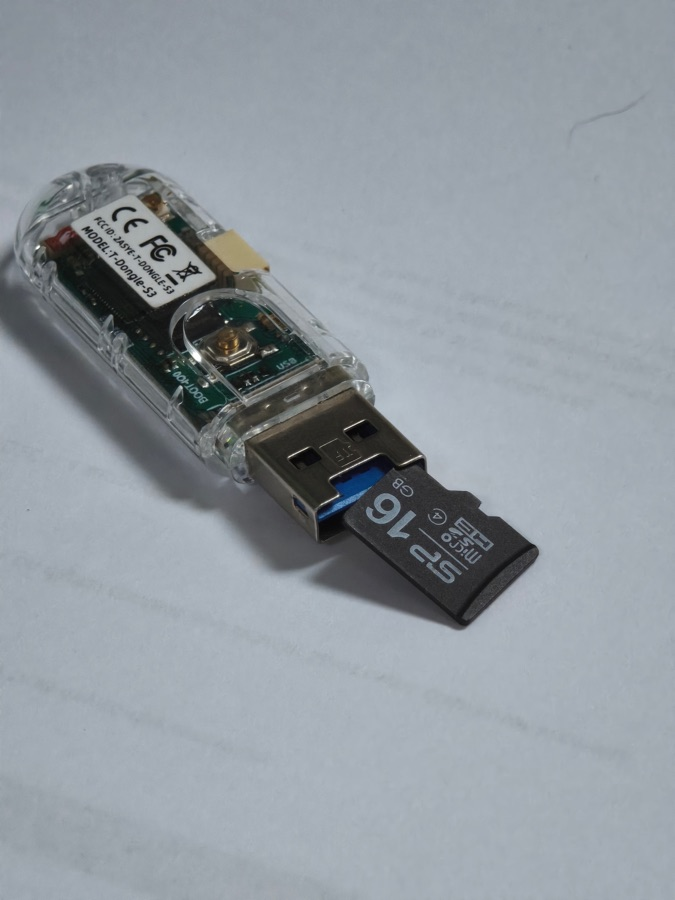
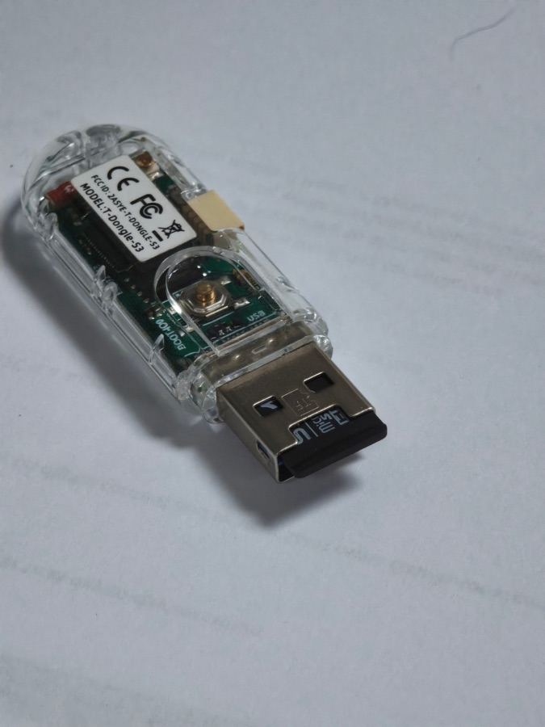
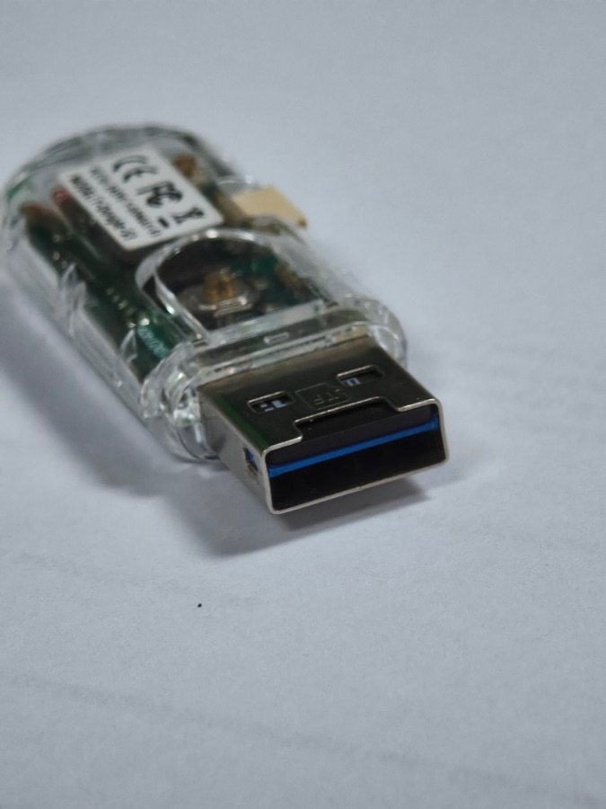
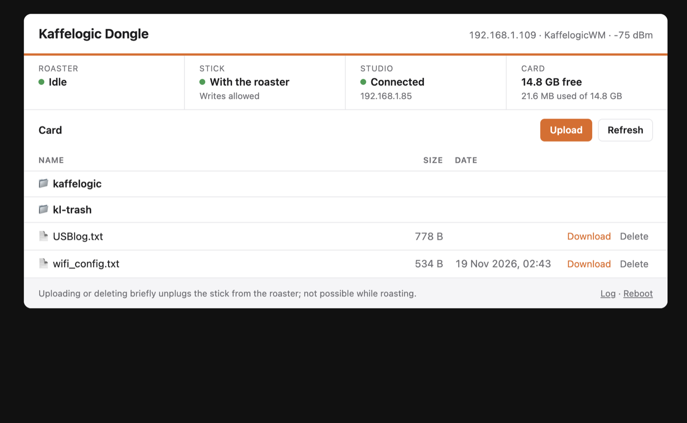

# KLDongle: the same idea on a LILYGO T-Dongle-S3

WiFi sync and live roast graphs for a Kaffelogic Nano 7 with the **older main board** (USB-A port, stick only), on a
[LILYGO T-Dongle-S3](https://github.com/Xinyuan-LilyGO/T-Dongle-S3): an ESP32-S3 with a USB-A plug, a microSD slot and
an RGB LED. It plugs straight into the roaster. No case, no cable, no Raspberry Pi.

<p align="center">
  
  
</p>

- **To the roaster it is a USB stick**: its microSD card holds your profiles and receives the roast logs.
- **To Kaffelogic Studio it looks like the WiFi module**: logs and profiles sync over WiFi, roasts show live, and
  profiles sent from Studio land on the card. This is a port of the Pi version's `kl-sassi`.
- **A web page** for browsing, downloading, uploading and deleting files on the card, with a status overview.
- **The dongle's IP address appears on the roaster** as a profile called `!ip` (right-hand photo).

> **Unofficial and lightly tested.** Not affiliated with Kaffelogic. Tried on a Nano 7 with the older board (Studio
> sync, live log of a roast). It writes to the card your roaster uses: keep a copy of your stick's files.

## What you need

- A **LILYGO T-Dongle-S3**. The version without a screen is the one that has been tried; the screen is not used.
- A **microSD card**, formatted FAT32, with the contents of your Kaffelogic stick copied onto it.
- A computer with **Chrome or Edge** for flashing (once).

## 1. Flash the firmware

The dongle has to be in **download mode** for flashing: hold the button on the dongle while you plug it into the
computer, then let go. (In normal use its USB port is the stick, so a computer cannot reach it without the button.)

**In the browser (easiest).** Open the flasher page:
[henrygreenslade.github.io/kl-zero-t-dongle/flash](https://henrygreenslade.github.io/kl-zero-t-dongle/flash/), click
**Install**, pick the port (`usbmodem…` on a Mac, `COM…` on Windows) and confirm. When it is done, unplug the
dongle and plug it in again *without* the button.

**From the command line.** With [esptool](https://docs.espressif.com/projects/esptool/) and the image from
[`docs/flash/`](../docs/flash/):

```
esptool --chip esp32s3 write-flash 0x0 kldongle-1.0.0.bin
```

Espressif's browser tool [esptool-js](https://espressif.github.io/esptool-js/) does the same: flash address `0x0`.

**From source** (Arduino IDE): see [Building](#building-it-yourself) below.

## 2. Prepare the card

1. Insert the microSD card. The slot is **inside the USB-A plug**: slide the card in label up, contacts first,
   until it sits flush with the end of the plug.

   <p align="center">
     
     
     
   </p>

2. Format the card **FAT32** (on a Mac: Disk Utility, *MS-DOS (FAT)*) and copy your stick's files onto it. You can
   do this with the card in the dongle: plugged into a computer, the dongle is just a USB disk.
3. Create `wifi_config.txt` in the root of the card. Only `SSID` and `PSK` are needed; the rest shows the defaults:

```
# WiFi Configuration
SSID=YourNetworkName
PSK=YourPassword

# Name Kaffelogic Studio looks for (LLMNR/NetBIOS/DHCP) - leave as is unless you know why
HOSTNAME=KaffelogicWM

# Serial number shown in Studio
SERIAL=KLDONGLE01

# 1 = Studio and the web page may write to the card (profiles, uploads, deletes)
# 0 = read-only: the stick never leaves the roaster
ALLOW_WRITE=1

# 1 = keep a profile named "!ip" whose name is the dongle's IP address
IP_PROFILE=1

# Keep-alive to Studio: bridge (default) or cr
KEEPALIVE=bridge
```

If the file is missing, the dongle creates a template on its first start. The file is read at power-up, so after
editing it, replug the dongle. On a Mac, **eject the card** before unplugging.

The dongle never formats a card itself: a card that fails to mount once must not be wiped. An unformatted card
makes the LED blink red, and the dongle still appears as a USB disk, so a computer can format it.

## 3. Use it

1. **Plug the dongle into the roaster.** The stick is available within a few seconds and WiFi a few seconds later.
   The `!ip` profile shows the dongle's address on the roaster's display.
2. **Studio**: enable *Options → Enable Wifi module discovery*. Studio looks for `KaffelogicWM` and should find the
   dongle on its own. It then syncs logs and profiles and shows roasts live.
3. **Web page**: `http://<ip>/` (or `http://kaffelogicwm.local/` on a Mac): status, files, and `/log` for the
   dongle's own log.



You can start a roast as soon as the profiles appear; Studio does not need to be connected. If it connects in the
middle of a roast, the live view starts from the beginning of that roast.

### LED

| Colour | Meaning |
|---|---|
| orange | starting |
| blinking green | USB stick working, no WiFi (check `wifi_config.txt`) |
| blue | WiFi connected |
| cyan (teal) | Studio connected: the usual resting colour |
| breathing orange ↔ red | roasting (the newest log is growing) |
| yellow | writing to the card; the stick is briefly away from the roaster |
| blinking red | no SD card, or the card is not formatted (FAT32) |

### Good to know

- **Writing never gets in the way of a roast.** A profile from Studio, an upload or a delete unplugs the stick from
  the roaster for about a second. This is refused while the roaster is writing (i.e. roasting) and for 20 s after.
  The page then says the roaster is busy; try again after the roast. `ALLOW_WRITE=0` makes the stick never leave
  the roaster.
- **Deleted files** go to `/kl-trash/` on the card. Deleting inside `/kl-trash/` is final.
- **Studio's *Wifi Module* tab** shows firmware `9.9.9` (so Studio considers it up to date). Do **not** use the
  *Install* links there: they are for the official module. Studio's *Roast date* column stays empty: the roaster has
  no clock. The dongle records real start times itself and shows them on the web page.
- **Adding profiles**: use Studio or the web page. Copying with the Mac's Finder leaves hidden `._name.kpro` files
  that the roaster may list as broken profiles (`dot_clean -m /Volumes/<card>` removes them).
- **A `kaffelogic/firmware` folder** for the roaster's update mode is never touched by the dongle, and Studio cannot
  send firmware to the card through it.

## Troubleshooting

| Problem | What to do |
|---|---|
| Roaster says *USB error / check device* | Usually the FAT "dirty" flag, set when a computer did not eject the card. The dongle clears it at every start: replug it. Otherwise check the card is FAT32. |
| LED blinks green | No WiFi: check `SSID`/`PSK` in `wifi_config.txt`. The stick works without WiFi. |
| Studio does not find the dongle | Give the dongle a fixed address in your router and add `<ip> KaffelogicWM` to the PC's `hosts` file. |
| Upload or delete says *busy* | The roaster wrote within the last 20 s (roasting or just finished). Try again after the roast. |
| Something odd | `http://<ip>/log` shows what the dongle did, including any warning that the roaster tried to write while the stick was away. |

## Updating

Same as flashing: hold the button, plug into the computer, flash, replug. Your settings and files are on the card
and are not affected. The firmware version is shown at the bottom of the web page.

## How it works

- **USB stick**: TinyUSB mass storage that reads and writes the microSD card's sectors directly. The roaster sees
  the card exactly as you formatted it.
- **Reading** for Studio and the web page: a fresh FatFs mount for every operation, so nothing stale is cached while
  the roaster writes underneath. All SD access, from the roaster and from the dongle, goes through one lock, so
  commands to the card never interleave.
- **Writing**: the dongle soft-disconnects from the roaster, as if the stick were unplugged, writes through FatFs,
  unmounts, clears the FAT dirty flag (see the main README) and reconnects. The roaster only writes while roasting
  (one log file, a line appended every second), so writes are refused after any roaster write in the last 20 s.
  The window closes 1 s after the last write, and web uploads up to 64 KB are collected in RAM first. If the
  roaster tries to write while the stick is away, it is handed back immediately and the event is logged.
- **Roast detection**: a roast is running while the newest `logNNNN.klog` grows, or a newer log appears; 5 s
  without growth ends it (Studio then switches from the live view to the final log). The logs folder is only
  checked while the USB host has written recently. Plain write activity does not count as a roast, because a
  computer as USB host writes all the time. The live graph, the roast start time, the status page and the LED all
  use this.
- **Studio**: TCP port 9056, the same SASSI handling as `kl-sassi`, including the live log (see
  [docs/PROTOCOL.md](../docs/PROTOCOL.md)). The dongle answers LLMNR and NetBIOS queries for `KaffelogicWM` and
  registers that name as its DHCP host name. Files Studio pushes outside the profile folder (such as
  `last_connection_uuid`) are kept in the dongle's flash, never on the card. Firmware files are refused.
- **`!ip` profile**: written once WiFi is up, only when the address changed, and hidden from Studio.

| | Pi Zero version | T-Dongle-S3 version |
|---|---|---|
| Stick storage | image file on the Pi's SD card | the dongle's microSD card itself |
| Studio over WiFi | `kl-sassi` | port of `kl-sassi` (same protocol, same rules) |
| WiFi settings | Raspberry Pi OS | `wifi_config.txt` on the card |
| Web page | - | yes |
| Roast start times | `roast-dates.json` | kept in flash, shown on the web page |
| Writes from Studio | off by default | on by default (`ALLOW_WRITE=0` turns them off) |
| Ready after power-on | ~30 s (stick), ~1.5 min (Studio) | a few seconds |

## Building it yourself

1. Arduino IDE with the **esp32** boards package by Espressif, version 3.x (built and tested with 3.3.13).
2. Open `KLDongle/KLDongle.ino`. No extra libraries are needed.
3. Tools menu: Board **ESP32S3 Dev Module**, USB Mode **USB-OTG (TinyUSB)**, USB CDC On Boot **Disabled**,
   Flash Size **16MB**, PSRAM **Disabled**.
4. Put the dongle in download mode (button), upload, then replug it without the button.

To refresh the browser flasher after a change, merge the build into one image, put it in `docs/flash/` and update
the file name and version in `docs/flash/manifest.json`:

```
esptool --chip esp32s3 merge-bin -o kldongle-<version>.bin --flash-mode keep --flash-freq keep --flash-size keep \
  0x0 KLDongle.ino.bootloader.bin 0x8000 KLDongle.ino.partitions.bin 0xe000 boot_app0.bin 0x10000 KLDongle.ino.bin
```

The flasher page is served by GitHub Pages from the `docs/` folder of the `main` branch
(*Settings → Pages → Deploy from a branch → main, /docs*).

## Limitations

The same as the Pi version (one Studio connection, no roaster preferences or commands). Also:

- Pushes from Studio are limited to 256 KB (profiles are a few KB).
- The web page has no password. Use it on your own network only.
